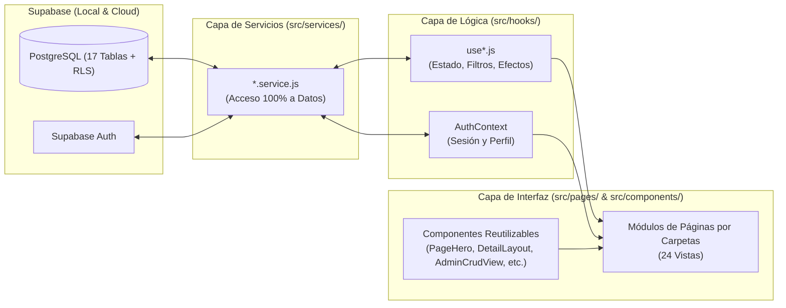

# ThakiGo — Plataforma de Turismo Local de Andacollo (Región de Coquimbo, Chile)

Plataforma web oficial e interactiva para descubrir, planificar y administrar el ecosistema turístico de la comuna de **Andacollo** en la Cuarta Región de Chile (**Región de Coquimbo**).

---

## 1. Objetivo del Proyecto

**ThakiGo** tiene como objetivo visibilizar y conectar a los visitantes con el patrimonio cultural, natural y de servicios de Andacollo bajo una experiencia visual moderna inspirada en plataformas de descubrimiento como TripAdvisor.

### Pilares Patrimoniales y Funcionales
1. **Turismo Religioso y Cultural**: Basílica Menor, Santuario de Nuestra Señora del Rosario de Andacollo, bailes chinos y festividades históricas.
2. **Astroturismo**: Ruta astronómica hacia el Observatorio Collowara y miradores de cielo oscuro con condiciones de observación en tiempo real.
3. **Turismo Minero**: Historia pirquinera, trapiches artesanales y museos comunales.
4. **Infraestructura y Servicios al Viajero**: Catálogos dinámicos de gastronomía local (restaurantes y picadas), alojamientos, eventos, experiencias guiadas, mapa interactivo, planificador de itinerarios, recomendaciones personalizadas y sistema de gamificación (logros, desafíos y tabla de posiciones).
5. **Panel de Administración Privado**: Gestión protegida por roles (`admin`) para crear, editar y eliminar sitios turísticos, restaurantes, alojamientos y eventos.

---

## 2. Arquitectura del Sistema

El proyecto sigue una **arquitectura modular en capas con separación estricta de responsabilidades** (`Services -> Hooks -> UI / Components`) sobre **React 18**, **Vite**, **CSS3 nativo** (`rem` con base `10px`) y **Supabase** (PostgreSQL + Auth + Row Level Security).



### Separación de Responsabilidades

1. **Base de Datos y Backend (`supabase/`)**:
   - **100% Datos Dinámicos**: Ninguna página contiene datos de negocio estáticos (hardcoded). Lugares, restaurantes, alojamientos, eventos, experiencias, pines del mapa, condiciones astronómicas, logros de gamificación, paradas del planificador y destacados del día residen en PostgreSQL.
   - **Migraciones (`supabase/migrations/`)**: Esquema relacional versionado con 17 tablas, triggers automáticos de creación de perfil y políticas Row Level Security (RLS), preparado con atributos `comuna` y `region` para escalar a toda la IV Región.
   - **Seeders (`supabase/seed.sql`)**: Carga inicial idempotente con información turística real de Andacollo para pruebas y demostraciones.
2. **Capa de Servicios (`src/services/*.service.js`)**:
   - Único punto de contacto con `src/lib/supabase.js`.
   - Ningún componente de página ni componente visual importa directamente el cliente de Supabase.
3. **Capa de Hooks y Controladores de Vista (`src/hooks/use*.js`)**:
   - Encapsula la lógica de negocio, estados de carga (`loading`), manejo de errores (`error`), búsqueda, filtrado y control de modales.
4. **Capa de Interfaz Modular (`src/pages/<PageName>/` y `src/components/`)**:
   - **Módulos de página separados por carpetas**: Cada página vive en su propio directorio con su vista `.jsx`, hoja de estilos `.css` y exportación `index.js`.
   - **Componentes Reutilizables Compartidos**: `PageHero`, `FilterTabs`, `LoadingState`, `EmptyState`, `FeedbackBanner`, `ConfirmModal` (reemplazando diálogos nativos del navegador), `DetailLayout` y `AdminCrudView`.

### Estructura de Directorios

```text
web-turismo/
├── README.md                                # Documentación integral del proyecto
├── AGENTS.md                                # Reglas y directrices técnicas del proyecto
├── package.json                             # Scripts de frontend y base de datos
├── .env.example                             # Plantilla de variables de entorno
├── design/                                  # Referencias visuales de diseño
├── supabase/                                # Entorno local de Supabase
│   ├── config.toml                          # Configuración de puertos y servicios CLI
│   ├── migrations/
│   │   └── 20261120000001_initial_schema.sql # DDL de 17 tablas, triggers Auth y RLS
│   └── seed.sql                             # Datos semilla de Andacollo
└── src/
    ├── main.jsx
    ├── App.jsx                              # Definición de rutas públicas, protegidas y admin
    ├── lib/
    │   └── supabase.js                      # Cliente único de Supabase
    ├── context/
    │   └── AuthContext.jsx                  # Estado global de sesión apoyado en auth.service.js
    ├── services/                            # 14 servicios de acceso a datos
    ├── hooks/                               # 17 hooks personalizados de lógica de vista
    ├── components/                          # Catálogo de componentes reutilizables
    │   ├── admin/                           # AdminCrudModal, AdminCrudView
    │   ├── auth/                            # ProtectedRoute, AdminRoute
    │   ├── layout/                          # Header, Footer, AdminSidebar, DetailLayout
    │   └── ui/                              # Button, Card, CategoryIcon, SearchBar, StarRating,
    │                                        # PageHero, FilterTabs, LoadingState, EmptyState,
    │                                        # FeedbackBanner, ConfirmModal
    ├── pages/                               # 19 páginas públicas/viajero en carpetas individuales
    │   └── admin/                           # 5 páginas administrativas en carpetas individuales
    └── styles/                              # Variables de diseño (rem base 10px) y estilos globales
```

---

## 3. Comandos para Iniciar el Proyecto (Local, Base de Datos, Front, Back y Despliegues)

### Requisitos Previos
- **Node.js** `>= 18.x` y **npm**
- **Docker** (requerido únicamente si deseas levantar los contenedores locales de Supabase CLI con `npm run db:start`)

### A. Instalación Inicial y Variables de Entorno

```bash
# 1. Instalar dependencias del proyecto
npm install

# 2. Crear archivo de variables de entorno local a partir de la plantilla
cp .env.example .env
```

Edita `.env` con las credenciales de tu instancia local de Supabase CLI o de tu proyecto en Supabase Cloud:

```env
VITE_SUPABASE_URL=http://127.0.0.1:54321
VITE_SUPABASE_ANON_KEY=<tu-anon-key>
```

### B. Comandos de Base de Datos y Backend (Supabase Local, Migraciones y Seeders)

| Acción | Comando NPM | Comando Equivalente Supabase CLI | Descripción |
| :--- | :--- | :--- | :--- |
| **Iniciar BD Local** | `npm run db:start` | `npx supabase start` | Levanta PostgreSQL (`54322`), API Gateway (`54321`), Studio (`54323`) e Inbucket (`54324`). |
| **Ver Estado y Claves** | `npm run db:status` | `npx supabase status` | Muestra las URLs locales, `anon key` y `service_role key`. |
| **Reiniciar BD + Migraciones + Seeders** | `npm run db:reset` | `npx supabase db reset` | Recrea la base de datos local desde cero, aplica `supabase/migrations/` e inserta `supabase/seed.sql`. |
| **Aplicar Migraciones Pendientes** | `npm run db:migrate` | `npx supabase migration up` | Aplica nuevas migraciones SQL locales sin borrar los datos actuales. |
| **Recargar Datos Semilla** | `npm run db:seed` | `npx supabase db reset` | Ejecuta nuevamente el ciclo completo de migraciones y seeders locales. |
| **Detener BD Local** | `npm run db:stop` | `npx supabase stop` | Detiene los contenedores locales de Supabase. |
| **Desplegar Migraciones a Producción** | `npm run db:push` | `npx supabase db push` | Aplica las migraciones locales pendientes en el proyecto remoto vinculado de Supabase Cloud. |

> **Nota si usas Supabase Cloud sin Docker local**: Puedes copiar y ejecutar directamente el contenido de `supabase/migrations/20261120000001_initial_schema.sql` seguido de `supabase/seed.sql` en el **SQL Editor** del panel web de Supabase.

### C. Comandos de Frontend (Desarrollo, Compilación y Previsualización)

| Acción | Comando | Descripción |
| :--- | :--- | :--- |
| **Servidor de Desarrollo** | `npm run dev` | Inicia Vite en modo desarrollo con Hot Module Replacement en `http://localhost:5173`. |
| **Compilar para Producción** | `npm run build` | Genera los archivos estáticos optimizados en la carpeta `dist/`. |
| **Previsualizar Producción** | `npm run preview` | Sirve localmente la compilación de `dist/` en `http://localhost:4173` para pruebas previas al despliegue. |

---

## 4. Consideraciones para Despliegues (Staging y Producción)

### 1. Variables de Entorno en elProveedor de Hosting Frontend
En plataformas como Netlify, Cloudflare Pages, Vercel o servidores propios, configura las variables de entorno de compilación:
- `VITE_SUPABASE_URL`: URL pública de tu proyecto en Supabase Cloud (`https://<project-ref>.supabase.co`).
- `VITE_SUPABASE_ANON_KEY`: Clave pública anónima (`anon` / `public`) de Supabase. **Nunca** expongas la clave `service_role` en el frontend.

### 2. Aplicación de Migraciones y Seeders en Base de Datos Remota
1. Vincula tu repositorio con el proyecto remoto:
   ```bash
   npx supabase login
   npx supabase link --project-ref <tu-project-ref>
   ```
2. Empuja el esquema de las 17 tablas y políticas RLS:
   ```bash
   npm run db:push
   ```
3. Si deseas poblar el entorno remoto con el catálogo inicial de Andacollo, ejecuta el script `supabase/seed.sql` desde el **SQL Editor** de Supabase (el script es idempotente gracias a las cláusulas `ON CONFLICT DO UPDATE`).

### 3. Configuración de Autenticación y Redirecciones (Supabase Auth)
- En el panel de Supabase (`Authentication -> URL Configuration`), actualiza:
  - **Site URL**: `https://tu-dominio-produccion.cl`
  - **Redirect URLs**: Añade `https://tu-dominio-produccion.cl/**` para permitir confirmaciones de correo e inicio de sesión.
- Para asignar permisos de administrador a un usuario registrado y habilitar el acceso a `/admin`, actualiza su rol en la tabla `public.profiles`:
  ```sql
  UPDATE public.profiles SET rol = 'admin' WHERE id = '<uuid-del-usuario>';
  ```

### 4. Seguridad de Datos (Row Level Security - RLS)
- Todas las tablas tienen **RLS habilitado por defecto** en la migración inicial:
  - **Visitantes anónimos**: Solo tienen permiso `SELECT` sobre los catálogos públicos activos.
  - **Viajeros autenticados**: Pueden gestionar únicamente sus propios registros en `favoritos`, `usuario_insignias`, `usuario_desafios` y editar su propio perfil en `profiles`.
  - **Administradores (`rol = 'admin'`)**: Verificados en el servidor mediante la función `public.is_admin()` (`SECURITY DEFINER`), siendo los únicos autorizados para ejecutar `INSERT`, `UPDATE` y `DELETE` sobre `lugares`, `restaurantes`, `alojamientos`, `eventos`, `experiencias`, `categorias` y `destacados_dia`.

### 5. Enrutamiento SPA (Single-Page Application)
- Dado que la aplicación utiliza `BrowserRouter` (`react-router-dom`), el servidor web o CDN de producción debe redirigir todas las rutas (`/*`) hacia `/index.html` con código HTTP `200` para evitar errores `404` al recargar rutas como `/explorar`, `/lugar/:id` o `/admin`.
