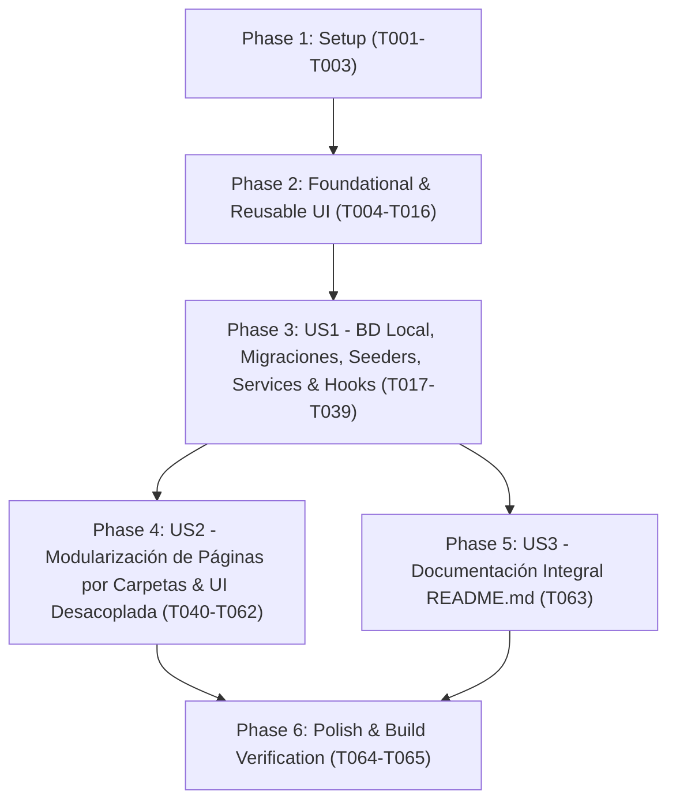

# Tasks: Arquitectura Modular, Datos 100% Dinámicos en Supabase y Documentación Integral

**Input**: Design documents from `/specs/001-modular-architecture-supabase/`

**Prerequisites**: [plan.md](file:///home/i/Documentos/web-turismo/specs/001-modular-architecture-supabase/plan.md), [spec.md](file:///home/i/Documentos/web-turismo/specs/001-modular-architecture-supabase/spec.md), [research.md](file:///home/i/Documentos/web-turismo/specs/001-modular-architecture-supabase/research.md), [data-model.md](file:///home/i/Documentos/web-turismo/specs/001-modular-architecture-supabase/data-model.md), [architecture-contracts.md](file:///home/i/Documentos/web-turismo/specs/001-modular-architecture-supabase/contracts/architecture-contracts.md)

**Tests**: No se solicitaron suites de tests unitarios externos (por restricción de cero dependencias adicionales); la validación se realiza mediante compilación `vite build`, validación estática de contratos/imports y verificación de migraciones/seeders en base de datos local (`quickstart.md`).

**Organization**: Las tareas están agrupadas por fases e historias de usuario (`US1`, `US2`, `US3`) para permitir una implementación y validación incremental e independiente.

## Format: `[ID] [P?] [Story] Description`

- **[P]**: Puede ejecutarse en paralelo (archivos diferentes, sin dependencias bloqueantes en curso).
- **[Story]**: Historia de usuario a la que pertenece la tarea (`[US1]`, `[US2]`, `[US3]`).
- Todas las tareas incluyen rutas de archivo exactas.

---

## Phase 1: Setup (Shared Infrastructure)

**Purpose**: Inicialización de directorios de arquitectura (`supabase/`, `src/services/`, `src/hooks/`), plantillas de variables de entorno y scripts NPM para gestión local y despliegues.

- [X] T001 Create architecture directories `supabase/migrations/`, `src/services/`, and `src/hooks/` per implementation plan
- [X] T002 [P] Create environment variables template with local and remote Supabase connection keys in `.env.example`
- [X] T003 [P] Add Supabase local CLI scripts (`db:start`, `db:stop`, `db:status`, `db:reset`, `db:migrate`, `db:seed`, `db:push`) to `package.json`

---

## Phase 2: Foundational (Blocking Prerequisites)

**Purpose**: Configuración base de Supabase local, cliente resiliente, hook genérico de carga asíncrona, servicio de autenticación y catálogo de componentes UI reutilizables que habilitan todas las historias de usuario.

**⚠️ CRITICAL**: Ninguna historia de usuario puede comenzar hasta completar esta fase.

- [X] T004 Configure local Supabase CLI environment (API port `54321`, DB port `54322`, Studio port `54323`, Auth settings, and `seed.sql` path) in `supabase/config.toml`
- [X] T005 Enhance Supabase client initialization with fallback warning in Spanish when env vars are missing in `src/lib/supabase.js`
- [X] T006 [P] Implement base asynchronous data and error handling hook `useAsyncData(fetcherFn, deps)` in `src/hooks/useAsyncData.js`
- [X] T007 [P] Implement `auth.service.js` (`getSession`, `onAuthStateChange`, `signIn`, `signUp`, `signOut`, `getProfile`, `updateProfile` against `auth.users` and `profiles`) in `src/services/auth.service.js`
- [X] T008 Refactor `AuthContext` to delegate all Supabase Auth and `profiles` table calls to `src/services/auth.service.js` in `src/context/AuthContext.jsx`
- [X] T009 [P] Create reusable `LoadingState` component (`fullPage`, `message` in Spanish) in `src/components/ui/LoadingState/LoadingState.jsx`, `src/components/ui/LoadingState/LoadingState.css`, and `src/components/ui/LoadingState/index.js`
- [X] T010 [P] Create reusable `EmptyState` component (`icon`, `title`, `description`, `actionLabel`, `actionTo`, `onAction`) in `src/components/ui/EmptyState/EmptyState.jsx`, `src/components/ui/EmptyState/EmptyState.css`, and `src/components/ui/EmptyState/index.js`
- [X] T011 [P] Create reusable `FeedbackBanner` component (`type`: `'error' | 'success' | 'info'`, `message`, `onDismiss`, `role="alert"`) in `src/components/ui/FeedbackBanner/FeedbackBanner.jsx`, `src/components/ui/FeedbackBanner/FeedbackBanner.css`, and `src/components/ui/FeedbackBanner/index.js`
- [X] T012 [P] Create reusable `ConfirmModal` component in the DOM (`isOpen`, `title`, `message`, `confirmLabel`, `cancelLabel`, `onConfirm`, `onCancel`, `loading`) to replace native `window.confirm` in `src/components/ui/ConfirmModal/ConfirmModal.jsx`, `src/components/ui/ConfirmModal/ConfirmModal.css`, and `src/components/ui/ConfirmModal/index.js`
- [X] T013 [P] Create reusable `PageHero` component (`eyebrow`, `title`, `subtitle`, `bgClass`, `bgImage`, `children`) in `src/components/ui/PageHero/PageHero.jsx`, `src/components/ui/PageHero/PageHero.css`, and `src/components/ui/PageHero/index.js`
- [X] T014 [P] Create reusable `FilterTabs` component (`tabs`, `activeTab`, `onChange`, `variant`: `'tabs' | 'chips' | 'explorer'`, `ariaLabel`) in `src/components/ui/FilterTabs/FilterTabs.jsx`, `src/components/ui/FilterTabs/FilterTabs.css`, and `src/components/ui/FilterTabs/index.js`
- [X] T015 [P] Create reusable `DetailLayout` component for all 5 entity detail views in `src/components/layout/DetailLayout/DetailLayout.jsx`, `src/components/layout/DetailLayout/DetailLayout.css`, and `src/components/layout/DetailLayout/index.js`
- [X] T016 Create reusable `AdminCrudView` component integrating `AdminSidebar`, table rendering, `AdminCrudModal`, `ConfirmModal`, and `FeedbackBanner` in `src/components/admin/AdminCrudView/AdminCrudView.jsx`, `src/components/admin/AdminCrudView/AdminCrudView.css`, and `src/components/admin/AdminCrudView/index.js`

**Checkpoint**: Infraestructura de Supabase local, `auth.service.js`, `useAsyncData` y componentes reutilizables listos.

---

## Phase 3: User Story 1 - Consulta y Gestión de Contenido 100% Dinámico desde Base de Datos (Priority: P1) 🎯 MVP

**Goal**: Garantizar que el 100% de los datos de negocio de Andacollo provengan de la base de datos Supabase (incluyendo migraciones SQL de las 17 tablas, políticas RLS, triggers, seeders completos, capa de servicios y capa de hooks de datos), eliminando la necesidad de datos hardcoded en las vistas.

**Independent Test**: Ejecutar las migraciones y `supabase/seed.sql` en la base de datos local y verificar que los 14 servicios en `src/services/` y 16 hooks de dominio en `src/hooks/` consulten y muten todas las entidades (`categorias`, `lugares`, `restaurantes`, `alojamientos`, `eventos`, `experiencias`, `favoritos`, `astronomia_*`, `destacados_dia`, `insignias`, `desafios`, `rutas_paradas`, `profiles`) sin datos fijos en el código.

### Database Schema, Migrations & Seeders for User Story 1

- [X] T017 [US1] Create complete database schema migration with all 17 tables (`profiles` with `rol` `'viajero' | 'admin'`, `nivel` DEFAULT 1, `xp` DEFAULT 0; `categorias` with `slug` UK `'religion' | 'astronomia' | 'mineria' | 'naturaleza' | 'cultura' | 'gastronomia' | 'trekking'`; `lugares`; `restaurantes` with `precio_rango` `'$' | '$$' | '$$$'`; `alojamientos`; `eventos`; `experiencias` with `categoria` `'Tours' | 'Gastronomía' | 'Aventura'`; `favoritos` with `UNIQUE(user_id, tipo, item_id)` and `tipo` `'lugar' | 'restaurante' | 'alojamiento' | 'evento' | 'experiencia'`; `astronomia_condiciones`; `astronomia_horarios` with `calidad` `'good' | 'best'`; `astronomia_recursos` with `tipo` `'consejo' | 'equipo'`; `destacados_dia` with `tipo` `'weather' | 'event' | 'promo'` and `variante` `'dark' | 'gold'`; `insignias`; `usuario_insignias`; `desafios`; `usuario_desafios`; `rutas_paradas` with `duracion_viaje` `'Medio día' | '1 día' | '2 – 3 días' | '+3 días'` and `presupuesto` `'Económico' | 'Moderado' | 'Premium'`), `comuna` DEFAULT `'Andacollo'`, `region` DEFAULT `'Coquimbo'`, auth trigger `handle_new_user`, and Row Level Security (RLS) policies in `supabase/migrations/20261120000001_initial_schema.sql`
- [X] T018 [US1] Create idempotent database seeder with complete Andacollo tourism data covering all 17 tables (categories, heritage/astronomic/mining/nature places with map coordinates `mapa_x`/`mapa_y`/`color_pin`, restaurants, accommodations, cultural and astronomic events, experiences, astronomy conditions/times/tips/gear, daily highlights, gamification badges/challenges/sample traveler profiles for leaderboard, and trip planner itinerary stops) in `supabase/seed.sql`

### Data Services Layer (`src/services/`) for User Story 1

- [X] T019 [P] [US1] Implement `categories.service.js` (`getCategories`, `getCategoryBySlug`) in `src/services/categories.service.js`
- [X] T020 [P] [US1] Implement `places.service.js` (`getPlaces`, `getPlaceById`, `getNearbyPlaces`, `savePlace`, `deletePlace`) in `src/services/places.service.js`
- [X] T021 [P] [US1] Implement `restaurants.service.js` (`getRestaurants`, `getRestaurantById`, `getOtherRestaurants`, `saveRestaurant`, `deleteRestaurant`) in `src/services/restaurants.service.js`
- [X] T022 [P] [US1] Implement `accommodations.service.js` (`getAccommodations`, `getAccommodationById`, `getOtherAccommodations`, `saveAccommodation`, `deleteAccommodation`) in `src/services/accommodations.service.js`
- [X] T023 [P] [US1] Implement `events.service.js` (`getEvents`, `getEventById`, `getOtherEvents`, `saveEvent`, `deleteEvent`) in `src/services/events.service.js`
- [X] T024 [P] [US1] Implement `experiences.service.js` (`getExperiences`, `getExperienceById`, `getOtherExperiences`) in `src/services/experiences.service.js`
- [X] T025 [P] [US1] Implement `favorites.service.js` (`getUserFavoritesByType`, `isItemFavorite`, `toggleFavorite`, `removeFavoriteById`, `getUserFavoritesCount`) in `src/services/favorites.service.js`
- [X] T026 [P] [US1] Implement `astronomy.service.js` (`getAstronomyPageData` fetching `astronomia_condiciones`, `astronomia_horarios`, `astronomia_recursos`, astronomic `lugares`, and astronomic `eventos`) in `src/services/astronomy.service.js`
- [X] T027 [P] [US1] Implement `map.service.js` (`getMapPins` unifying georeferenced pins from `lugares`, `restaurantes`, and `alojamientos` with filter and search support) in `src/services/map.service.js`
- [X] T028 [P] [US1] Implement `gamification.service.js` (`getGamificationData` querying `profiles` leaderboard, `insignias`, `usuario_insignias`, `desafios`, and `usuario_desafios`) in `src/services/gamification.service.js`
- [X] T029 [P] [US1] Implement `planner.service.js` (`getPlannerOptions` and `generateItinerary` querying `categorias` and `rutas_paradas` filtered by duration, interests, and budget) in `src/services/planner.service.js`
- [X] T030 [P] [US1] Implement `recommendations.service.js` (`getHomeHighlights` and `getRecommendationsPageData` querying `destacados_dia`, top `lugares`, `restaurantes`, `experiencias`, and `eventos`) in `src/services/recommendations.service.js`
- [X] T031 [P] [US1] Implement `admin.service.js` (`getDashboardStats`, `getCrudRecords`, `saveCrudRecord`, `deleteCrudRecord`) in `src/services/admin.service.js`

### Domain Hooks Layer (`src/hooks/`) for User Story 1

- [X] T032 [P] [US1] Implement `useHomeData` hook (consuming `places.service`, `categories.service`, and `recommendations.service`) in `src/hooks/useHomeData.js`
- [X] T033 [P] [US1] Implement `useExplorerData` hook (managing URL search params, active tab, search query, and dynamic entity loading) in `src/hooks/useExplorerData.js`
- [X] T034 [P] [US1] Implement `useEntityDetail` hook (managing single entity loading, related items, favorite status toggle via `favorites.service`, and description expansion for all 5 detail pages) in `src/hooks/useEntityDetail.js`
- [X] T035 [P] [US1] Implement `useRestaurants`, `useAccommodations`, `useEvents`, and `useExperiences` catalog hooks in `src/hooks/useRestaurants.js`, `src/hooks/useAccommodations.js`, `src/hooks/useEvents.js`, and `src/hooks/useExperiences.js`
- [X] T036 [P] [US1] Implement `useAstronomy` and `useMapExplorer` hooks in `src/hooks/useAstronomy.js` and `src/hooks/useMapExplorer.js`
- [X] T037 [P] [US1] Implement `useGamification`, `useTripPlanner`, and `useRecommendations` hooks in `src/hooks/useGamification.js`, `src/hooks/useTripPlanner.js`, and `src/hooks/useRecommendations.js`
- [X] T038 [P] [US1] Implement `useFavorites` and `useProfileStats` hooks in `src/hooks/useFavorites.js` and `src/hooks/useProfileStats.js`
- [X] T039 [P] [US1] Implement `useAdminDashboard` and `useAdminCrud` hooks (managing CRUD records, form modal state, `ConfirmModal` deletion state without `window.confirm`, and `FeedbackBanner` notifications) in `src/hooks/useAdminDashboard.js` and `src/hooks/useAdminCrud.js`

**Checkpoint**: Base de datos local con migraciones + seeders y capas completas de `src/services/` y `src/hooks/` listas para alimentar el 100% de la aplicación desde Supabase.

---

## Phase 4: User Story 2 - Organización Modular por Páginas y Separación de Responsabilidades (Priority: P2)

**Goal**: Reestructurar todas las páginas de la aplicación en carpetas modulares independientes (`src/pages/<PageName>/` y `src/pages/admin/<AdminPageName>/`), conectándolas exclusivamente a los hooks de `src/hooks/` y componentes reutilizables de `src/components/`, eliminando todos los datos estáticos en las vistas y los archivos planos antiguos.

**Independent Test**: Verificar que cada una de las 24 páginas resida en su propia carpeta con su `.jsx`, `.css` (si aplica) e `index.js`, que ninguna página ni componente importe `src/lib/supabase.js`, que no exista ningún `window.confirm` ni arreglo de datos de negocio hardcoded, y que `src/App.jsx` enrute todas las vistas sin regresiones visuales.

### Modularization of Reusable Components & Public Discovery Pages

- [X] T040 [P] [US2] Organize existing UI, Layout, and Admin components into modular folders with `index.js` barrel exports (`Button`, `Card`, `CategoryIcon`, `SearchBar`, `StarRating`, `Header`, `Footer`, `AdminSidebar`, `AdminCrudModal`) under `src/components/`
- [X] T041 [P] [US2] Modularize `LandingPage` into `src/pages/LandingPage/LandingPage.jsx`, `src/pages/LandingPage/LandingPage.css`, and `src/pages/LandingPage/index.js` using `FeedbackBanner` and separating auth form handler logic
- [X] T042 [P] [US2] Modularize `HomePage` into `src/pages/HomePage/HomePage.jsx`, `src/pages/HomePage/HomePage.css`, and `src/pages/HomePage/index.js` consuming `useHomeData` (dynamic categories, featured place, recommended places, and daily highlight banner from DB) and `LoadingState`
- [X] T043 [P] [US2] Modularize `ExplorerPage` into `src/pages/ExplorerPage/ExplorerPage.jsx`, `src/pages/ExplorerPage/ExplorerPage.css`, and `src/pages/ExplorerPage/index.js` consuming `useExplorerData`, `PageHero`, `FilterTabs`, `LoadingState`, and `EmptyState`
- [X] T044 [P] [US2] Modularize `MapPage` into `src/pages/MapPage/MapPage.jsx`, `src/pages/MapPage/MapPage.css`, and `src/pages/MapPage/index.js` consuming `useMapExplorer` (100% database-driven pins and filter types instead of hardcoded `MAP_PINS`), `FilterTabs`, `LoadingState`, and `EmptyState`
- [X] T045 [P] [US2] Modularize `AstronomyPage` into `src/pages/AstronomyPage/AstronomyPage.jsx`, `src/pages/AstronomyPage/AstronomyPage.css`, and `src/pages/AstronomyPage/index.js` consuming `useAstronomy` (100% database-driven conditions, best times, recommended spots, astronomic events, tips, and gear instead of hardcoded constants), `PageHero`, and `LoadingState`

### Modularization of Public Catalog & Entity Detail Pages

- [X] T046 [P] [US2] Modularize `RestaurantsPage` into `src/pages/RestaurantsPage/RestaurantsPage.jsx`, `src/pages/RestaurantsPage/RestaurantsPage.css`, and `src/pages/RestaurantsPage/index.js` consuming `useRestaurants`, `PageHero`, `FilterTabs`, `LoadingState`, and `EmptyState`
- [X] T047 [P] [US2] Modularize `AccommodationsPage` into `src/pages/AccommodationsPage/AccommodationsPage.jsx`, `src/pages/AccommodationsPage/AccommodationsPage.css`, and `src/pages/AccommodationsPage/index.js` consuming `useAccommodations`, `PageHero`, `LoadingState`, and `EmptyState`
- [X] T048 [P] [US2] Modularize `EventsPage` into `src/pages/EventsPage/EventsPage.jsx`, `src/pages/EventsPage/EventsPage.css`, and `src/pages/EventsPage/index.js` consuming `useEvents`, `FilterTabs`, `LoadingState`, and `EmptyState`
- [X] T049 [P] [US2] Modularize `ExperiencesPage` into `src/pages/ExperiencesPage/ExperiencesPage.jsx`, `src/pages/ExperiencesPage/ExperiencesPage.css`, and `src/pages/ExperiencesPage/index.js` consuming `useExperiences`, `PageHero`, `FilterTabs`, `LoadingState`, and `EmptyState`
- [X] T050 [P] [US2] Modularize `PlaceDetailPage` into `src/pages/PlaceDetailPage/PlaceDetailPage.jsx` and `src/pages/PlaceDetailPage/index.js` using `useEntityDetail('lugar', id)` and reusable `DetailLayout`
- [X] T051 [P] [US2] Modularize `RestaurantDetailPage` into `src/pages/RestaurantDetailPage/RestaurantDetailPage.jsx` and `src/pages/RestaurantDetailPage/index.js` using `useEntityDetail('restaurante', id)` and reusable `DetailLayout`
- [X] T052 [P] [US2] Modularize `AccommodationDetailPage` into `src/pages/AccommodationDetailPage/AccommodationDetailPage.jsx` and `src/pages/AccommodationDetailPage/index.js` using `useEntityDetail('alojamiento', id)` and reusable `DetailLayout`
- [X] T053 [P] [US2] Modularize `EventDetailPage` into `src/pages/EventDetailPage/EventDetailPage.jsx` and `src/pages/EventDetailPage/index.js` using `useEntityDetail('evento', id)` and reusable `DetailLayout`
- [X] T054 [P] [US2] Modularize `ExperienceDetailPage` into `src/pages/ExperienceDetailPage/ExperienceDetailPage.jsx` and `src/pages/ExperienceDetailPage/index.js` using `useEntityDetail('experiencia', id)` and reusable `DetailLayout`

### Modularization of Protected Traveler & Admin Pages

- [X] T055 [P] [US2] Modularize `RecommendationsPage` into `src/pages/RecommendationsPage/RecommendationsPage.jsx`, `src/pages/RecommendationsPage/RecommendationsPage.css`, and `src/pages/RecommendationsPage/index.js` consuming `useRecommendations` (100% database-driven highlights, for-you cards, and other recommendations instead of hardcoded arrays) and `LoadingState`
- [X] T056 [P] [US2] Modularize `TripPlannerPage` into `src/pages/TripPlannerPage/TripPlannerPage.jsx`, `src/pages/TripPlannerPage/TripPlannerPage.css`, and `src/pages/TripPlannerPage/index.js` consuming `useTripPlanner` (100% database-driven interests and itinerary stops from `rutas_paradas` instead of hardcoded `GENERATED_ROUTE`)
- [X] T057 [P] [US2] Modularize `FavoritesPage` into `src/pages/FavoritesPage/FavoritesPage.jsx`, `src/pages/FavoritesPage/FavoritesPage.css`, and `src/pages/FavoritesPage/index.js` consuming `useFavorites`, `FilterTabs`, `LoadingState`, and `EmptyState`
- [X] T058 [P] [US2] Modularize `GamificationPage` into `src/pages/GamificationPage/GamificationPage.jsx`, `src/pages/GamificationPage/GamificationPage.css`, and `src/pages/GamificationPage/index.js` consuming `useGamification` (100% database-driven level, badges, active challenges, and leaderboard from Supabase instead of hardcoded constants) and `LoadingState`
- [X] T059 [P] [US2] Modularize `ProfilePage` into `src/pages/ProfilePage/ProfilePage.jsx`, `src/pages/ProfilePage/ProfilePage.css`, and `src/pages/ProfilePage/index.js` consuming `useProfileStats` (dynamic user favorite/visit statistics) and `FeedbackBanner`
- [X] T060 [P] [US2] Modularize `DashboardPage` into `src/pages/admin/DashboardPage/DashboardPage.jsx`, `src/pages/admin/DashboardPage/DashboardPage.css`, and `src/pages/admin/DashboardPage/index.js` consuming `useAdminDashboard` and `LoadingState`
- [X] T061 [P] [US2] Modularize `PlacesAdminPage`, `RestaurantsAdminPage`, `AccommodationsAdminPage`, and `EventsAdminPage` into `src/pages/admin/PlacesAdminPage/`, `src/pages/admin/RestaurantsAdminPage/`, `src/pages/admin/AccommodationsAdminPage/`, and `src/pages/admin/EventsAdminPage/` using `useAdminCrud` and `AdminCrudView` (with `ConfirmModal` instead of `window.confirm`)
- [X] T062 [US2] Update route imports in `src/App.jsx` to point to the modular page directories and remove all old flat `.jsx` and `.css` files from `src/pages/` and `src/pages/admin/`

**Checkpoint**: Las 24 páginas están organizadas en carpetas modulares, separadas en `Services -> Hooks -> UI`, reutilizando componentes compartidos y sin datos hardcoded.

---

## Phase 5: User Story 3 - Puesta en Marcha Local y Despliegue Guiado por Documentación (README) (Priority: P3)

**Goal**: Documentar exhaustivamente en `README.md` el objetivo del proyecto, la arquitectura en capas y modular, todos los comandos para iniciar en local, gestionar base de datos (migraciones, seeders, reset), frontend, backend y las consideraciones para despliegues en producción.

**Independent Test**: Revisar `README.md` y verificar que contenga las 4 secciones principales requeridas por el usuario (Objetivo del proyecto, Arquitectura con diagrama y árbol de directorios, Comandos para local/BD/migraciones/seeders/front/back/despliegues, y Consideraciones para despliegues) y que todos los comandos coincidan con `package.json` y `supabase/config.toml`.

- [X] T063 [US3] Write comprehensive `README.md` in Spanish documenting Project Objective (Andacollo tourism platform & 3 heritage pillars), Layered & Modular Architecture (`Services`, `Hooks`, `UI`, `Components`, `Supabase` Data Model), Commands (Local setup, DB start/stop/reset/migrations/seeders, Frontend dev/build/preview, Backend/Supabase CLI deployment), and Deployment Considerations (Environment variables, remote migrations, RLS security, Auth redirects, and SPA routing) in `README.md`

**Checkpoint**: Documentación `README.md` completa y alineada con la arquitectura implementada.

---

## Phase 6: Polish & Cross-Cutting Concerns

**Purpose**: Verificación integral de cumplimiento arquitectónico, reglas de la Constitución/`AGENTS.md` y compilación de producción.

- [X] T064 Run static architecture verification to confirm zero direct `supabase` client imports in `src/pages/` and `src/components/`, zero occurrences of `alert(`, `confirm(`, `prompt(`, or `innerHTML` across `src/`, and zero remaining flat files in `src/pages/`
- [X] T065 Execute production build validation (`npm run build`) and verify all quickstart validation scenarios from `specs/001-modular-architecture-supabase/quickstart.md`

---

## Dependencies & Execution Order

### Phase Dependencies

- **Setup (Phase 1)**: Sin dependencias — puede iniciar inmediatamente.
- **Foundational (Phase 2)**: Depende de Phase 1 — **BLOQUEA** todas las historias de usuario porque provee `supabase/config.toml`, `auth.service.js`, `useAsyncData` y los componentes UI reutilizables base.
- **User Story 1 (Phase 3 - P1 🎯 MVP)**: Depende de Phase 2 — construye las migraciones SQL, los seeders de las 17 tablas, los 13 servicios de dominio y los 15 hooks de datos.
- **User Story 2 (Phase 4 - P2)**: Depende de Phase 2 y Phase 3 — modulariza las 24 páginas en sus carpetas conectándolas a los hooks de `US1` y componentes reutilizables de Phase 2.
- **User Story 3 (Phase 5 - P3)**: Puede redactarse en paralelo con Phase 4 una vez definidos los scripts de Phase 1 y la estructura de Phase 2/3, finalizando con la verificación de rutas reales.
- **Polish (Phase 6)**: Depende de que `US1`, `US2` y `US3` estén completadas.

### User Story Dependencies



### Parallel Opportunities

- **Phase 1**: `T002` (`.env.example`) y `T003` (`package.json`) pueden ejecutarse en paralelo.
- **Phase 2**: Los componentes reutilizables `T009` (`LoadingState`), `T010` (`EmptyState`), `T011` (`FeedbackBanner`), `T012` (`ConfirmModal`), `T013` (`PageHero`), `T014` (`FilterTabs`) y `T015` (`DetailLayout`) son completamente independientes y pueden crearse en paralelo.
- **Phase 3 (US1)**:
  - Los 13 servicios (`T019` a `T031`) operan en archivos separados dentro de `src/services/` y pueden implementarse en paralelo.
  - Los hooks de dominio (`T032` a `T039`) pueden implementarse en paralelo una vez creados sus servicios respectivos.
- **Phase 4 (US2)**:
  - La modularización por carpetas de cada página (`T041` a `T061`) opera sobre subdirectorios independientes (`src/pages/<PageName>/`) y puede ejecutarse en lotes paralelos antes de actualizar `src/App.jsx` en `T062`.

---

## Parallel Example: User Story 1 & User Story 2

```bash
# Ejemplo 1 (US1): Crear servicios de acceso a datos en paralelo
Task T020: "Implement places.service.js in src/services/places.service.js"
Task T021: "Implement restaurants.service.js in src/services/restaurants.service.js"
Task T026: "Implement astronomy.service.js in src/services/astronomy.service.js"
Task T028: "Implement gamification.service.js in src/services/gamification.service.js"

# Ejemplo 2 (US2): Modularizar páginas de detalle en paralelo usando DetailLayout y useEntityDetail
Task T050: "Modularize PlaceDetailPage into src/pages/PlaceDetailPage/"
Task T051: "Modularize RestaurantDetailPage into src/pages/RestaurantDetailPage/"
Task T052: "Modularize AccommodationDetailPage into src/pages/AccommodationDetailPage/"
Task T053: "Modularize EventDetailPage into src/pages/EventDetailPage/"
Task T054: "Modularize ExperienceDetailPage into src/pages/ExperienceDetailPage/"
```

---

## Implementation Strategy

### MVP First (User Story 1 + Core Modularization)

1. Completar **Phase 1: Setup** (`T001`–`T003`).
2. Completar **Phase 2: Foundational** (`T004`–`T016`) para disponer de `supabase/config.toml`, `auth.service.js` y el catálogo de componentes reutilizables.
3. Completar **Phase 3: User Story 1** (`T017`–`T039`) para tener el esquema completo de 17 tablas en `supabase/migrations/`, los datos semilla en `supabase/seed.sql`, y todas las capas `src/services/` y `src/hooks/`.
4. **Validación intermedia**: Verificar que todos los servicios y hooks compilen y respondan a la estructura de base de datos sin datos estáticos.

### Incremental Delivery

1. **Entrega 1 (Datos y Base Local - US1)**: Esquema de Supabase local, migraciones, seeders, servicios y hooks listos.
2. **Entrega 2 (Modularización de Páginas y UI Reutilizable - US2)**: Las 24 páginas migradas a sus carpetas modulares (`src/pages/<Module>/`), consumiendo únicamente hooks y componentes compartidos, sin `window.confirm` ni llamadas directas a Supabase.
3. **Entrega 3 (Documentación y Validación Final - US3 + Polish)**: `README.md` completo con arquitectura, comandos y guía de despliegue, verificado con `vite build`.
